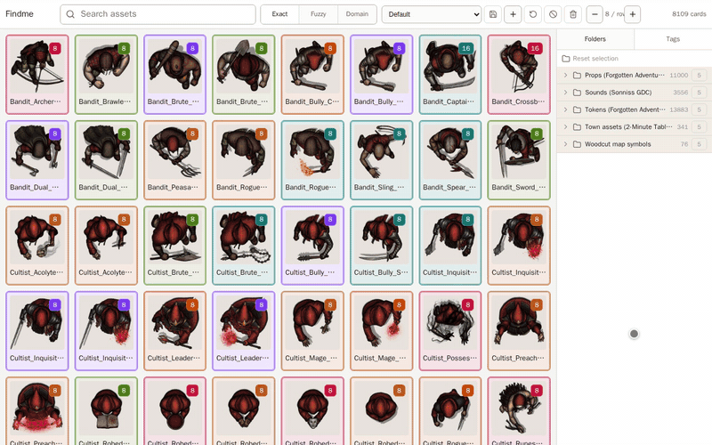
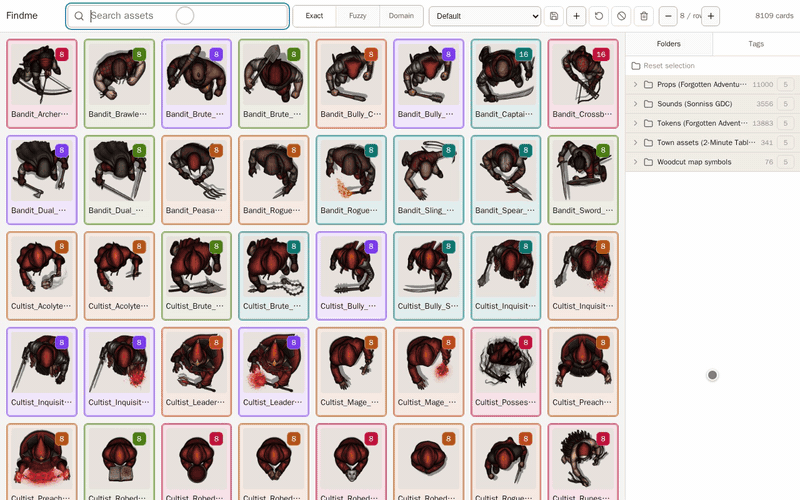
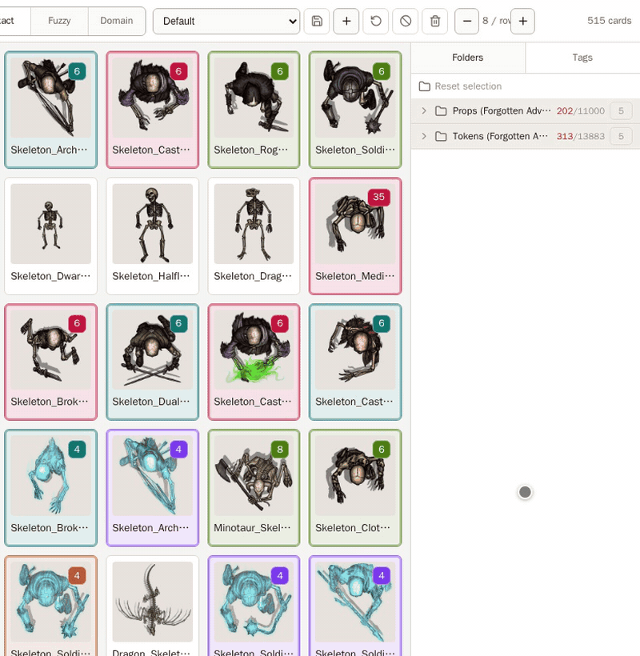
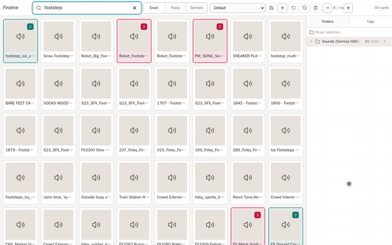
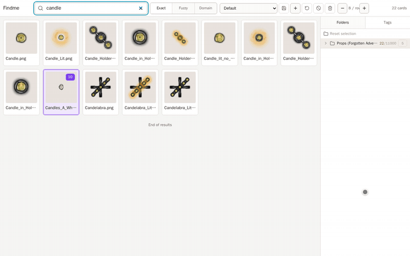

# findme

findme is a very responsive, self-hosted file search for a large local library of images, video and audio. Results update as you type: most searches take under 30 ms, and thumbnails appear immediately. I use it on a home server for a tabletop RPG library of about 250,000 maps, tokens and sound files.



## Features

- Incremental indexing of one or more source folders. Files with unchanged size and modification time are skipped. Source folders are only read, the index and thumbnails live in a separate data directory.
- Three search modes: exact (token and prefix matches), fuzzy (tolerates typos) and domain (expands terms through a hand-edited vocabulary, so `adventurer` also finds `warrior` or `mage`).

  

- Folder tree with match counts per folder. Selecting folders filters the results, and each folder can get a quality weight that moves its files up or down in the ranking.

  

- Search profiles that save folder selections and ranking weights.
- Virtualized thumbnail grid with pregenerated sizes (256 px, optionally 512 and 1024 px), video posters and audio previews on hover.

  

- Per-file actions: open or download the original, copy the image or its thumbnail, copy the absolute path, copy a path rewritten for a virtual tabletop (configured per source, for example FoundryVTT), open the folder in a File Browser instance. Enter copies the default path of the selected file.
- Tags with autocomplete, stored against a hash of the file content rather than its path.

  

- Keyboard navigation: `/` focuses the search field, arrow keys or `hjkl` move the selection.
- `findme search-eval` checks ranking expectations written in YAML, used to tune search against a real library.

On my library, typical exact and fuzzy searches take 6 to 30 ms on the server, domain searches about 200 ms.

## Architecture

- **Backend:** Python 3.13 and FastAPI, served by uvicorn. The `findme` CLI covers `init-db`, `index`, `rebuild-search-corpus`, `cleanup-thumbnails`, `serve` and `search-eval`.
- **Indexing and storage:** SQLite holds files, folders, thumbnail references and tags. The indexer reads image metadata with Pillow and video and audio metadata with ffprobe, and writes thumbnails as files under the data directory.
- **Search:** after each index run the app builds a search corpus from SQLite. The heavy lifting runs in compiled libraries rather than in Python loops: tantivy (a Rust search library) does lexical matching, rapidfuzz (C++) scores fuzzy matches, and ranking and folder counts are vectorized over in-memory numpy arrays. The domain mode expands queries through `config/search-vocabulary.yaml`, and one request returns both the result page and the folder counts.
- **Frontend:** Svelte 5 and TypeScript, built with Vite. The backend serves the built files from `frontend/dist`.

## Running with Docker Compose

You need Docker with Compose, or Podman with a Compose provider.

1. Create your settings and config:

   ```sh
   cp .env.example .env
   cp config/findme.example.toml config/findme.local.toml
   ```

   In `.env`, set `FINDME_MEDIA` to the folder with your files. `compose.yaml` mounts it read-only at `/assets` in the container, the path the example config indexes. Add a `[[sources]]` block to the config per folder if you want several sources. Both files are ignored by git.

2. Build the image, create the database, index your files and start the server:

   ```sh
   mkdir -p data
   docker compose build
   docker compose run --rm --no-deps findme findme init-db --config config/findme.toml
   docker compose run --rm --no-deps findme findme index --config config/findme.toml
   docker compose up -d
   ```

   Inside the container your config is `config/findme.toml`. The app is then at http://localhost:48317 (`FINDME_PORT` in `.env`).

To pick up new or changed files, index again and restart:

```sh
docker compose exec findme findme index --config config/findme.toml
docker compose restart findme
```

With Podman on an SELinux host, the volumes need a `:z` label. Put the three `volumes` entries from `compose.yaml` into a `compose.override.yaml` (ignored by git) with `:z` appended (`:ro,z` for the read-only ones).

## Development and tests

Backend (needs [uv](https://docs.astral.sh/uv/) and ffmpeg on the `PATH`):

```sh
uv sync --extra dev
uv run pytest
```

Frontend:

```sh
cd frontend
npm ci
npm test                          # Vitest unit tests
npm run check                     # svelte-check and tsc
npx playwright install chromium
npm run test:e2e                  # Playwright, against a mocked API
```

To run the app locally, put some images into `sample-assets/` (ignored by git) and start the backend on port 8002, where the Vite dev server proxies `/api`:

```sh
uv run findme init-db --config config/findme.dev.toml
uv run findme index --config config/findme.dev.toml
uv run findme serve --config config/findme.dev.toml --port 8002
npm --prefix frontend run dev
```

`search-eval/dnd.yaml` refers to files in my own library, so `findme search-eval` only runs against it. It shows the format for writing an evaluation set for another library.

## Status and limitations

- Built for one user on a trusted network. There is no authentication, so do not expose it to the internet.
- Indexing is manual. The app does not watch folders for changes.
- Configuration is a TOML file. There is no settings page.
- Only tested on Linux.
- The notes in `docs/` and `trackers/` are working notes from development and describe my own setup.

## How it was built

I designed findme and wrote its first version (indexer, lexical search, thumbnail grid and folder tree). Most later features were developed with an AI coding agent (Codex), following the instructions in `AGENTS.md`.

## Licence

MIT, see [LICENSE](LICENSE).

The demo GIFs in `docs/demo/` show third-party assets, which are not covered by the MIT licence:

- Tokens and props by [Forgotten Adventures](https://www.forgotten-adventures.net)
- Sound effects from the [Sonniss GDC Game Audio Bundles](https://sonniss.com/gameaudiogdc)
- Town & City assets by [2-Minute Tabletop](https://2minutetabletop.com), [CC BY-NC 4.0](https://creativecommons.org/licenses/by-nc/4.0/)
- Woodcut map symbols by Robbinsmoth and Elvanos, [CC BY 4.0](https://creativecommons.org/licenses/by/4.0/)
